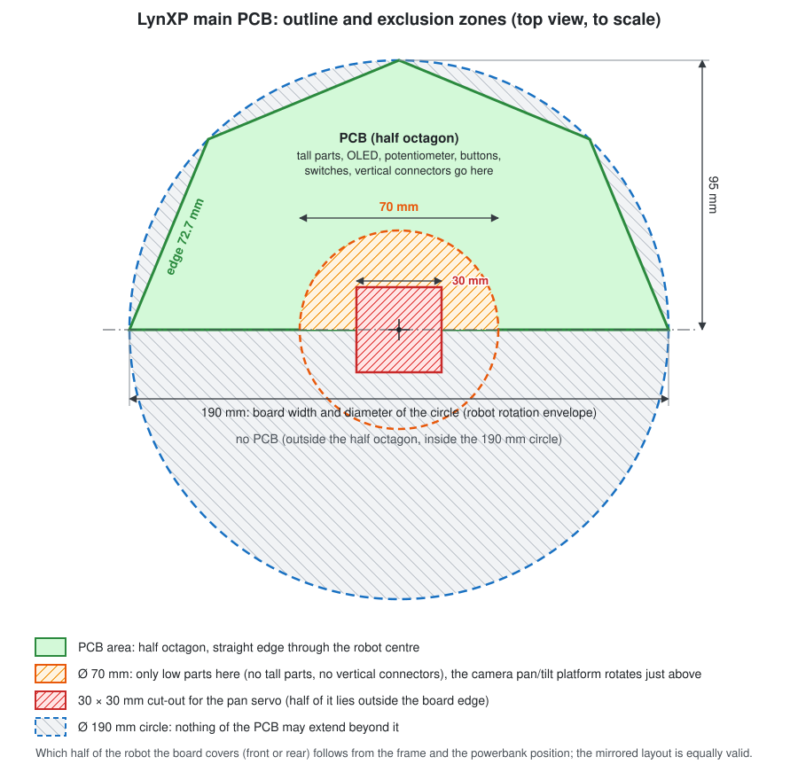

# LynXP main PCB — requirements

This document lists the requirements for a single main PCB that replaces the breadboard, the
breakout modules and the wiring of LynXP One (see [powerbank_circuit.png](powerbank_circuit.png)
and the [BOM in the README](../README.md#bill-of-materials)). As many functions as practical
should be on the PCB itself instead of on plug-in modules.

Key words: **must** = hard requirement, **should** = strongly preferred, **may** = optional/nice to have.
Items marked *(verify)* are facts the designer must check against the current datasheet before
committing to the layout.

---

## 1. Scope: what moves onto the PCB

| Function | LynXP One (breadboard) | PCB |
|---|---|---|
| Main MCU | Waveshare ESP32-C5-WIFI6-KIT devkit | **ESP32-C5-WROOM-1U** module soldered on the PCB |
| USB-PD trigger | Adafruit HUSB238 breakout | **HUSB238** chip + USB-C receptacle on the PCB |
| Current/voltage sensor | Adafruit INA260 breakout | **INA260** chip on the PCB |
| 5 V buck converter | OT253-B47 module | Buck converter on the PCB |
| 3.3 V supply | Devkit LDO | Regulator on the PCB |
| Motor driver | TB6612FNG module | **TB6612FNG** chip on the PCB |
| Servo PWM | ESP32 LEDC | **PCA9685** 16-channel PWM driver (motor PWM stays on ESP32 LEDC) |
| Extra GPIO | — | **MCP23017** 16-bit I/O expander |
| Analog inputs | — | **8-channel I²C ADC** for add-on sensors (new, see §5.2) |
| Programming | Devkit USB | One USB-C port to the ESP32-C5 native USB (no USB-UART chip) |
| Camera (XIAO ESP32-S3 Sense) | Loose jumper wires | Keyed connector for a 4-wire flat cable |
| OLED display | 1.3" 128×64 I²C module on jumper wires | **1.3" 128×64 OLED integrated on the PCB** (strongly recommended; 4-pin header acceptable, see §5.1) |
| nOOds LED, buttons, power switch | Loose wires | Connectors / on-board parts |
| Headlights | — | Two headlight outputs with connectors (new, see §11.1) |
| Microphone, speaker | — | **Optional, very low priority**: on-board I²S microphone and speaker amplifier (new, see §11.2); better done on the camera's ESP32-S3 |
| Dynamixel XL430 smart servos | — | **Wish**: Dynamixel TTL port with its own adjustable supply, level shifter and half-duplex converter (new, see §11.3) |

Stays off-board: powerbank, motors, servos (including optional Dynamixel smart servos), XIAO ESP32-S3 Sense camera, nOOds LED, headlights, optional speaker/mic.

---

## 2. Power input: USB-PD (HUSB238)

### 2.1 Negotiation
- **Must** have a USB-C receptacle (power only; CC1, CC2, VBUS, GND) for the powerbank; its VBUS net is named
  **VBUS_PD**. The connector is labelled
  **"POWER"** on the silkscreen, clearly different from the programming port.
- **Must** use the HUSB238 as PD sink controller. Default request: **12 V** (the GM37 motors are
  12 V motors; LynXP One ran them at 9 V).
- **Should** allow selecting the requested voltage (at least 9 V and 12 V; 5/15/20 V a bonus) with
  solder jumpers or a DIP switch on the HUSB238 voltage-select resistor network *(verify resistor
  values in the HUSB238 datasheet)*. The ISET/current resistor (10.5 kΩ on LynXP One) must also be
  on the board.
- **Must** connect the HUSB238 I²C (address 0x08) to the main I²C bus so firmware can read the
  contract and optionally request another PDO.
- The negotiated voltage is distributed as rail **V_BUS** (12 V by default). Its voltage depends on
  the selected/negotiated PDO (e.g. 9 V if the powerbank cannot deliver 12 V, or 15 V if selected).
  Everything on V_BUS must therefore work from 5 V up to 20 V.

### 2.2 On/off switch that wakes the powerbank (important)
Many powerbanks (including the Anker Zolo) switch their output off after a period of low current,
and only turn it on again when they detect a *new* attach event on the CC lines. Pulling and
re-inserting the cable works; switching the load does not.

- **Must**: the main on/off switch breaks the **CC1 and CC2** lines between the USB-C receptacle and
  the HUSB238 (one pole per CC line). Switching OFF looks like a cable unplug to the powerbank (it
  removes VBUS_PD itself); switching ON is a fresh attach, which wakes the powerbank.
- **Must**: the same switch also puts the **PD controller to sleep when OFF and wakes it when ON**,
  so that every switch-on starts the PD controller from its initial state and it renegotiates the
  contract, instead of keeping stale state alive on residual VBUS_PD/bulk-capacitor charge or on
  voltage back-fed from the programming USB port. Implement with an extra pole on the main switch,
  e.g. driving the PD controller's enable/sleep pin, or cutting its supply combined with a VBUS_PD
  discharge path so it gets a clean power-on reset *(verify which mechanism the HUSB238 supports;
  a comparable PD sink controller with a proper enable pin is acceptable if the HUSB238 has none)*.
- The main switch is therefore a multi-pole switch (e.g. 3PDT/4PDT slide or toggle). There must be
  only this one power switch for the PD input; no separate wake/sleep buttons.
  - Side effect: the switch carries only CC signal current, so no high-current switch is needed.
  - Keep CC traces short, place the switch close to the receptacle and the HUSB238. The switch
    must be a real mechanical switch, large and easy to reach from outside the robot (panel or
    edge mount, or wired to an off-board panel switch via a small connector with a footprint for
    an on-board switch as well).
- **Should** use another pole of the same main switch to also open the PD output load switch,
  so the output is guaranteed off even with a non-compliant source.
- Note: the powerbank must be connected with a **USB-C to USB-C** cable. A USB-A to C cable has
  no CC handshake and cannot be woken or switched this way.

### 2.3 Inrush and capacitance
- USB-C limits sink bulk capacitance on VBUS_PD before a contract is established (≤10 µF *(verify)*).
  Large bulk capacitors (motor/servo rails) **must** sit behind a load switch/PMOS that only closes
  once the HUSB238 reports a valid contract (as the Adafruit breakout does), with soft-start.

### 2.4 Protection
- **Must**: TVS diode on VBUS_PD rated for the maximum selectable PD voltage (≥ 20 V standoff if 20 V
  can be selected).
- No fuse on the PCB: overcurrent protection is provided by the powerbank, which cuts its output
  when the negotiated current (~2.5–3 A at 12 V for a 30 W powerbank) is exceeded.

### 2.5 Current sensing (INA260)
- **Must** place an INA260 (integrated shunt, high-side) in series with V_BUS directly after
  the PD output switch, so it measures the complete robot consumption.
- I²C address: **0x40** (firmware `INA260_I2C_ADDR`), A0 and A1 hardwired to GND.
- ALERT pin left unconnected.

---

## 3. Power rails

| Rail | Source | Minimum rating | Notes |
|---|---|---|---|
| **V_BUS** (12 V default; VBUS_PD after PD load switch and INA260) | HUSB238 | 3 A | Motors (TB6612 VM), buck inputs, exposed |
| **5 V** logic | Buck from V_BUS | 3 A | Camera, nOOds, exposed |
| **V_SERVO** (5 V default) | Separate buck from V_BUS | 3 A | 8 servo headers |
| **3.3 V** | Regulator from 5 V | 1 A | ESP32-C5, MCP23017, PCA9685, INA260, HUSB238 I/O, encoders |
| **V_DXL** (wish, §11.3) | Adjustable converter from V_BUS | 3 A | Dynamixel XL430 smart servos only; 6.5 V to at least 12 V, default 11.1 V |

- Net names: **VBUS_PD** = raw VBUS pin of the POWER connector; **VBUS_PROG** = raw VBUS pin of
  the PROG connector; **V_BUS** = main rail (VBUS_PD after load switch and INA260). Bare
  "VBUS" is not used as a net name.
- Bucks **must** accept 5–20 V input with margin (≥ 28 V abs. max) because the rail follows the PD
  voltage.
- Servos **should** get their own buck, separate from logic 5 V, so servo stall currents
  (MG996R ~2.5 A stall) cannot brown out the ESP32. Bulk capacitance on V_SERVO (≥ 470–1000 µF,
  low-ESR).
- 3.3 V regulator must handle ESP32-C5 Wi-Fi peaks (≥ 500 mA peak for the module alone); an LDO
  from 5 V with ≥ 1 A rating or a small buck.
- When only the programming USB port is connected, the 5 V/3.3 V logic **must** run from **VBUS_PROG** (the
  programming port's VBUS)
  through an ORing diode / ideal diode, without back-feeding into the buck output or the PD side.
  V_SERVO and V_BUS stay unpowered in that case.
- **Must**: power-good LED on each rail (V_BUS, 5 V, V_SERVO, 3.3 V); **should** also on V_DXL if the Dynamixel port (§11.3) is included.
- **Should**: test points on every rail and GND.

### 3.1 Exposed power
- **Must** expose **all rails — V_BUS, V_SERVO, 5 V, 3.3 V — and GND**, so they can feed
  additional external components, both on:
  - **screw terminals** (5.0 mm or 3.5 mm pitch, one terminal per rail + at least two GND), and
  - **2.54 mm female headers** (several pins per rail, e.g. a 2×N or 4×1 block per rail).
- Silkscreen voltage next to every pin. Use distinct connector colours or clear markings to avoid
  plugging a 3.3 V device into V_BUS. Silkscreen names V_BUS and V_SERVO with their
  default voltage (e.g. "V_BUS (12 V)").

---

## 4. Main MCU: ESP32-C5-WROOM-1U

- **Must** use ESP32-C5-**WROOM-1U**, the variant with an antenna connector (U.FL/IPEX) for an
  external antenna. The WROOM-1 variant with PCB antenna is not acceptable. A variant **with PSRAM is required**
  (current devkit is N16R8); choose flash/PSRAM size to match the firmware partition table
  ([partitions.csv](../Firmware/Robot_ESP32_C5_IDF/partitions.csv)) *(verify availability)*.
- **Must** route the U.FL cable to an external antenna mounting point away from motors, the metal
  frame and the powerbank; keep the module away from the buck converters and motor traces.
  A 2.4/5 GHz dual-band external antenna with U.FL cable is part of the BOM.
- **Must**: EN reset button, BOOT button on GPIO28, EN RC delay
  (10 kΩ / 1 µF), decoupling per module datasheet.
- Reserved pins (from [board_pins.hpp](../Firmware/Robot_ESP32_C5_IDF/main/board_pins.hpp)):
  GPIO13/14 = USB D−/D+, GPIO16–22 = flash/PSRAM, **GPIO15 cannot be used** (PSRAM).
- Strapping: **GPIO28 must not be externally driven** — only the BOOT button may pull it low. It
  may only connect to inputs (e.g. the Dynamixel data input, §11.3). The other
  strapping pins need no special care.

### 4.1 Programming port
- **Must**: exactly one USB-C receptacle, labelled **"PROG"**, wired to the ESP32-C5 native
  USB-Serial/JTAG (GPIO13/14). No USB-UART converter chip. 5.1 kΩ Rd on its own CC1/CC2, ESD
  protection on D+/D− (e.g. USBLC6-2), 90 Ω differential routing.
- **Must**: a 2.54 mm UART0 header for an external USB-UART adapter: GND, U0TXD, U0RXD
  (GPIO11/GPIO12 *(verify)*), plus EN and BOOT so an adapter can also flash the module. 3.3 V pin
  via solder jumper, open by default.

### 4.2 Suggested pin map
Pan/tilt servos move to the PCA9685 and motor direction pins to the MCP23017 (see §6, §7). Motor
PWM stays on native ESP32 pins (LEDC, 20–30 kHz, inaudible) on the same GPIOs as now; the remaining ESP32 pins keep the bench-verified LynXP One assignment. The designer may
reassign pins; any change must be documented so `board_pins.hpp` can be updated.

| Function | Connection |
|---|---|
| Motor PWMA (right) / PWMB (left) | 9 / 0 (LEDC; pull-downs so motors are off until firmware runs) |
| Motor AIN1, AIN2 (right) / BIN1, BIN2 (left) | MCP23017 GPA0, GPA1 / GPA2, GPA3 |
| Pan / tilt servo | PCA9685 channel 0 / 1 |
| Encoder left A, B | 26, 25 |
| Encoder right A, B | 24, 23 |
| I²C SDA / SCL | 2 / 3 |
| Camera SPI link (C5 is master, §10): SCLK / MOSI / MISO / CS | 5 / 6 / 8 / 10 (formerly the I²S pins; GPIO11/12 stay free for the UART0 header) |
| Screen-select potentiometer (§5.1) | GPIO1 (ADC1_CH0) |
| UART0 TX / RX | 11 / 12 *(verify)* |
| Addressable status LED + RGB LED strip header (§11) | 7 |

Any GPIOs left over (e.g. GPIO27, formerly the QR button) go to a 2.54 mm female header.
The pins that were the camera UART (GPIO4, GPIO28) and GPIO27 are free now: the optional Dynamixel port (§11.3) can use them (suggestion: RX on GPIO28, which may only be an input, TX on GPIO27, direction on GPIO4). A microphone and speaker (very low priority, §11.2) would sit on the camera's ESP32-S3 instead, so the C5 has no I²S pins reserved. The designer documents the final assignment.

Encoders **must** stay on native GPIOs (PCNT peripheral).

---

## 5. I²C bus

- One 3.3 V I²C bus shared by all devices, running at 400 kHz.
- **Must**: external SDA/SCL pull-up resistors to 3.3 V, populated by default (0805, e.g. 2.2 kΩ;
  value chosen for the total bus capacitance at 400 kHz). The ESP32-C5's internal pull-ups are not
  relied on.
- Address map (must be conflict-free — note the PCA9685 default **0x40 clashes with the INA260**):

| Device | Address |
|---|---|
| HUSB238 | 0x08 (fixed) |
| MCP23017 | 0x20 (A0–A2 solder jumpers) |
| OLED (SH1106/SSD1306-compatible) | 0x3C (0x3D via solder jumper) |
| INA260 | 0x40 (A0, A1 to GND) |
| PCA9685 | **0x41** (A0 to 3.3 V, A1–A5 to GND); its All-Call address 0x70 is also in use |
| 8-channel ADC (§5.2) | 0x48 (address pins to GND) |
| Board-ID EEPROM (§12.1) | 0x50 |

- **Should**: one or two Qwiic/STEMMA QT (JST-SH 4-pin, 3.3 V) connectors plus a 2.54 mm I²C
  header for add-ons.

### 5.1 On-board 1.3" OLED display
- **Strongly recommended**: the 1.3" 128×64 monochrome OLED is integrated on the PCB. Use a bare
  1.3" OLED glass panel with integrated controller and FPC tail (typically 30-pin, soldered or in
  an FPC connector), with all support circuitry on the PCB. Panel colour white (as on LynXP One);
  blue or yellow acceptable.
- Controller: the current firmware uses the SSD1306 driver with a 2-column offset
  (`CONFIG_OFFSETX=2` in [sdkconfig.defaults](../Firmware/Robot_ESP32_C5_IDF/sdkconfig.defaults)),
  i.e. the LynXP One module is effectively an **SH1106** (132-column RAM). An SH1106 panel is
  preferred so firmware stays unchanged; an SSD1306/SSD1309 panel is acceptable if documented.
  *(verify controller of the chosen panel)*
- Interface: **I²C** on the shared bus, address 0x3C (0x3D selectable). Interface-select pins
  (BS0–BS2) strapped for I²C, D1/D2 joined for SDA as the panel datasheet specifies.
- Supply: logic from 3.3 V. The OLED drive voltage (VCC/VPP, typically 7–15 V) must be generated
  as required by the controller: internal charge pump with its flying capacitors (SH1106/SSD1306),
  or a small external boost converter if the panel needs external VCC (e.g. SSD1309). Include
  IREF resistor, VCOMH/VCC decoupling and all other passives from the panel's reference circuit.
- RES# (reset) connected to an MCP23017 output or ESP32 GPIO with RC fallback, so firmware can
  reset a hung display.
- **Should**: the display power can be switched off (load switch or controller sleep is enough).
- Mechanical: the panel **must** be on the top side, fully visible with the robot assembled,
  readable in the orientation the robot is normally viewed from (text upright). Provide a cut-out
  or keep-out under the FPC bend, and a mounting method for the glass (double-sided foam tape
  area and/or a 3D-printed bezel with M2/M2.5 holes; include the bezel in the STEP deliverable).
  Keep tall components and connectors away from the panel so it is not damaged or shadowed.
- **Must**: a **potentiometer with turn knob directly right of the OLED**, used to select the screen
  shown. PCB-mount rotary
  potentiometer with shaft (e.g. 9 mm type, linear, 10 kΩ) and a knob large enough to turn by
  hand, between 3.3 V and GND, wiper to a native ESP32-C5 ADC pin with a 100 nF filter capacitor.
  The knob must be reachable with the robot assembled and not obstruct the view of the display.
- **Acceptable alternative** (only if integrating the panel is not feasible): a 4-pin 2.54 mm
  female header on the same I²C bus for a 1.3" OLED module, placed and with mounting holes so the
  module sits in the same position (display visible, potentiometer right of it). Note that the
  order of the 4 pins differs per manufacturer (e.g. GND-VCC-SCL-SDA vs VCC-GND-SCL-SDA), so the
  header needs solder jumpers for both common orders — one reason integration is strongly
  preferred. The on-panel requirements above (controller, charge pump, RES#) then do not apply.

### 5.2 8-channel ADC for analog sensors
Lets students add analog sensors (potentiometers, light sensors, IR distance sensors, line
sensors, etc.) without using ESP32 pins.
- **Must**: an 8-channel I²C ADC on the shared bus, ≥ 10-bit, e.g. **ADS7828** (12-bit, 8
  single-ended inputs, I²C 0x48–0x4B) or an equivalent available at JLCPCB/LCSC. Powered from 3.3 V;
  input range 0–3.3 V (reference = 3.3 V supply, or internal reference if the chosen part has a
  better one — document which).
- **Must**: **8 sensor connectors**, one per channel: 3-pin 2.54 mm male headers in the order
  **GND, 3.3 V, signal** (same style as the servo headers, so standard 3-wire sensor cables fit),
  labelled **A0–A7**, each with label space for the sensor name.
- Supply on these headers is 3.3 V only, so sensor outputs stay within the ADC range. No 5 V
  option; users with 5 V-only sensors add their own level shifting.
- Input protection per channel: series resistor (~1 kΩ) and clamping to 3.3 V/GND, plus footprints
  (unpopulated by default) for a pull-down resistor and an RC filter capacitor.

---

## 6. PCA9685 PWM driver: servos, headlights, LEDs

- **Must**: PCA9685 powered from 3.3 V (3.3 V signal levels are fine for hobby servos).
- **Must**: OE pin pulled **high** (outputs disabled) by default and controlled by MCP23017 **GPA7**
  (output-only pin; floats at reset so the pull-up keeps OE high), so servos receive no pulses
  until firmware has initialised them. This also prevents
  the random boot-time pan rotation seen on LynXP One.
- All 16 PCA9685 channels share one PWM frequency (~50 Hz for servos; the PCA9685 cannot exceed
  ~1.5 kHz), which is why motor PWM is not on the PCA9685.
- **Must**: **8 servo headers**, standard 3-pin 2.54 mm male (GND, V_SERVO, signal — in that
  order, with polarity marked on silkscreen), on PCA9685 channels 0–7:
  - channel 0 = **PAN**, channel 1 = **TILT**, channels 2–7 = **SPARE 1–6** (label space).
  - Series resistor (~220 Ω) on each signal line.
  - Spacing wide enough to plug in 8 servo connectors side by side.
- Channels 11 and 12: left and right **headlights** (§11.1).
- **Must**: break out PCA9685 channels 8, 9 and 13–15 on a 2.54 mm female header (with GND and 5 V next to it).
- **Should**: channel 10 drives a logic-level low-side MOSFET for the **nOOds LED** (dimmable),
  with footprint for the series resistor (47 Ω on LynXP One) and a 2-pin connector.

---

## 7. MCP23017 GPIO expander

- **Must**: MCP23017 at 3.3 V, RESET pulled up (optionally to a GPIO), INTA/INTB not
  connected (firmware polls the inputs).
- **Note** *(verify)*: newer MCP23017 datasheets specify **GPA7 and GPB7 as output-only**. Use these
  two pins for outputs (e.g. LEDs) and not for switches.
- Suggested allocation:
  - GPA0–GPA3: TB6612FNG AIN1, AIN2, BIN1, BIN2 (outputs). Pull-downs on these four lines so both
    motors are stopped while the MCP23017 is in reset or not yet configured.
  - 4-position DIP switch (inputs, see §9).
  - 4 large user buttons (inputs).
  - GPA7: PCA9685 OE (output, §6).
  - GPB7: speaker amplifier shutdown/mute (output, §11.2).
  - User LEDs (as needed).
  - All unused pins on a labelled 2.54 mm female header with GND and 3.3 V.

---

## 8. Motors

### 8.1 Driver
- **Must**: TB6612FNG on the PCB, VM = V_BUS, VCC = 3.3 V, STBY pulled up to 3.3 V (always
  enabled, as the current firmware assumes; no switch).
- Channel A = RIGHT motor, channel B = LEFT motor (matches firmware).
- Generous copper and thermal vias for the TB6612FNG (1.2 A continuous / 3.2 A peak per channel).
  GM37-520 stall current at 12 V should be checked against this *(verify)*; if it is too high, a
  pin-compatible-in-function alternative with IN1/IN2/PWM control may be proposed.
- Bulk capacitor (≥ 100 µF) and 100 nF at VM.

### 8.2 Motor connectors (per motor, both motors)
All three options on the board, electrically in parallel (only one used at a time):
1. **6-pin 2.0 mm pitch socket** matching the GM37-520 encoder motor cable (JST-PH-style).
   Signals: M+, M−, encoder VCC, encoder GND, encoder A, encoder B. Pin order **must** be checked
   against the actual TT Motor GM37-520TB-1250-30-EN cable *(verify)*; silkscreen the pin names.
2. **2.54 mm female header** (6-pin, same signals).
3. **2-pin screw terminal** for M+/M− only (motors without encoder, or thick wires).

### 8.3 Encoders
- Encoder VCC is **3.3 V**, so A/B connect directly to the ESP32 GPIOs (no selector jumper, no
  level limiting).
- Footprints for pull-ups and small RC filters (DNP by default) on each A/B line.
- Encoder spec (for reference): 12 PPR, 30:1 gearbox.

---

## 9. Switches, buttons and labels

- **Main power switch** (large, see §2.2): multi-pole, breaking CC1/CC2 and sleeping/waking the PD
  controller. No other power or enable switches (no motor-enable or servo-power switch), to avoid
  a switch being forgotten in the wrong state.
- **Must**: **4 large user buttons** (e.g. 12 mm tactile buttons with caps) on native GPIO or
  MCP23017, free for firmware/minigame use. There is no
  dedicated QR button any more; screen selection (including the QR code) is done with the
  potentiometer next to the OLED (§5.1).
- **Must**: at least one **4-position DIP switch** on the MCP23017 (e.g. robot ID, mode flags).
- **Must**: **space for labels** next to every user button, DIP position, spare servo, spare
  header and exposed rail: white solder-mask/silkscreen fields that can be written on with a
  permanent marker, large enough for a short word.
- Reset (EN) and BOOT buttons (small is fine).

---

## 10. Camera (XIAO ESP32-S3 Sense)

- The camera sits on the pan-tilt head. A **6-wire flat cable** is soldered to the XIAO and ends in
  a connector that plugs into the PCB. The link is **SPI** (the C5 is master, the XIAO's ESP32-S3
  slave; framing in [cam_link_proto.h](../Firmware/Robot_ESP32_C5_IDF/main/cam_link_proto.h)),
  replacing the former UART, so camera frames can later be streamed through the C5's own 5 GHz
  Wi-Fi.
- **Must**: keyed, latching/friction-locked 6-pin connector on the PCB (e.g. JST-PH 2.0 mm or
  JST-XH 2.5 mm; the designer selects one and specifies the mating cable connector); **should**: a
  7th pin reserved for a later "data ready" line from the XIAO. Pinout:

| Pin | Signal | XIAO side | ESP32-C5 side |
|---|---|---|---|
| 1 | 5 V | 5V pad | 5 V rail |
| 2 | GND | GND | GND |
| 3 | CAM_SCLK | D9 (GPIO8) | GPIO5 (SPI clock out) |
| 4 | CAM_MOSI | D10 (GPIO9) | GPIO6 (SPI data out) |
| 5 | CAM_MISO | D0 (GPIO1) | GPIO8 (SPI data in) |
| 6 | CAM_CS | D1 (GPIO2) | GPIO10 (chip select out) |
| (7) | (CAM_RDY, later) | (a free D pin) | (a free GPIO) |

  The breadboard setup uses GPIO11/12/4/28 for the same four signals (board_pins.hpp); on the PCB
  GPIO11/12 stay free for the UART0 header (§4.1).
- 3.3 V levels. Small series resistors (e.g. 100–330 Ω) on the four SPI lines, and a pull-up on
  CAM_CS (the XIAO's input is pulled up inside, but keep one on the board for while the C5
  resets). The SPI clock is 4 MHz, so keep the cable short and CAM_SCLK away from the antenna
  cable.
- Place the connector so the cable has room to follow the pan/tilt motion; provide a strain-relief
  point (hole for a cable tie) next to it.
- Budget ≥ 500 mA on the 5 V rail for the camera.
- Protect against back-feeding when the XIAO's own USB is plugged in for programming *(verify
  whether the XIAO already has a diode on its 5 V pin)*.

---

## 11. Other connectors and indicators

- Addressable status LED (WS2812/SK6812) on GPIO7.
- **Must**: **3-pin header for an addressable RGB LED strip** (WS2812/SK6812), pins **5 V, DATA,
  GND** (silkscreen order and arrow for data direction), e.g. JST-XH 2.5 mm or 2.54 mm header.
  - DATA is the continuation of the on-board status LED chain (status LED DOUT → strip DIN), so
    no extra GPIO is needed; the strip LEDs follow the status LED in the chain.
  - GPIO7 is level-shifted from 3.3 V to 5 V (e.g. 74AHCT1G125) before the status LED, which runs
    from 5 V; its DOUT then drives the strip at 5 V levels. ~330 Ω series resistor on DATA at the
    header; bulk capacitor (≥ 100 µF) on 5 V at the header.
  - Powered from the 5 V rail; strip length is limited by the 5 V budget (§3), to be noted on the
    silkscreen or in the documentation.
- nOOds LED 2-pin connector (see §6).
- Female header breakout of all free ESP32 GPIOs, MCP23017 spare pins and PCA9685 channels 8, 9 and 13–15,
  each group with GND and supply pins next to it.
- All connectors labelled on the silkscreen with signal name and voltage.

### 11.1 Headlights
- **Must**: two headlight outputs (LEFT, RIGHT), each a 2-pin connector (JST-PH 2.0 mm) for an
  off-board white LED mounted at the front of the robot.
- Each driven by a logic-level low-side MOSFET from PCA9685 channel 11/12 (dimmable), from the 5 V
  rail, up to 350 mA per output.
- Footprint for a current-limiting resistor per output (size for ≥ 1 W), so both small 5 mm LEDs and
  1 W power LEDs can be used. A small constant-current LED driver instead of the resistor is
  acceptable.

### 11.2 Microphone and speaker (optional, very low priority)
Microphone and speaker are **really low priority**: leave them out of the first board revisions (the
C5 has no pins reserved for them any more, §4.2). **Preferred way if audio is wanted at all**: use the
GPIOs of the **camera's XIAO ESP32-S3** instead of the main ESP32-C5. That ESP32 already streams the
video, so it can stream the audio over the same connection, without any audio signals having to
cross to the main board *(verify which XIAO ESP32-S3 Sense pins are free; the Sense board already
carries a PDM microphone, which may be enough for the microphone)*. A speaker amplifier would then
sit at the camera head, powered through the 5 V of the camera cable (§10). Only if audio on the
main board is really wanted, the following applies (the designer then has to find the I²S pins:
the four GPIOs reserved for them earlier now carry the camera SPI link, §10):
- On-board **I²S MEMS microphone** (e.g. ICS-43434 or INMP441-compatible, available at
  JLCPCB/LCSC), top-port so it fits single-sided assembly. Placed at a board edge, away from the
  motor driver, bucks and speaker connector; keep the sound port free (no silkscreen/solder mask
  over it, no parts on top of it).
- **I²S class-D amplifier** (e.g. MAX98357A) powered from the 5 V rail, driving a
  2-pin speaker connector (JST-PH 2.0 mm) for an off-board 4–8 Ω, 1–3 W speaker. Shutdown/mute
  pin to MCP23017 GPB7 (pulled to shutdown by default so the speaker is silent during boot).
- Microphone and amplifier share I²S BCLK and WS; separate data lines (see §4.2). Pin choice must
  match the ESP32-C5 I²S peripheral *(verify)*.
- Decouple the amplifier supply well (≥ 10 µF + 100 nF close to the chip) and route the speaker
  output as a short differential pair away from the microphone and the antenna cable.

### 11.3 Dynamixel XL430 smart servo port (wish)

Wish (**should**): a port for **Dynamixel XL430** smart servos (e.g. XL430-W250), for add-on arms,
grippers or pan/tilt heads with position feedback. It is a separate bus with its own supply, so
it is independent of the PCA9685 servo headers (§6). If the PCB gets too crowded, this is the first
function to drop; the rest of the design must not depend on it.

- **Connectors**: at least **two 3-pin sockets wired in parallel** (daisy chain, like the servos'
  own two ports), mating with the standard Dynamixel XL cable (JST EH 2.5 mm, housing EHR-03;
  e.g. PCB header B3B-EH-A or the side-entry S3B-EH) *(verify against the XL430 datasheet and
  the cable)*. Pin order **1 GND, 2 VDD (V_DXL), 3 DATA**, marked on the silkscreen together with
  the voltage setting, e.g. "DXL (set 11.1 V)". A vertical socket is a vertical connector: keep it
  outside the Ø 70 mm zone of §12.2.
- **Dedicated supply V_DXL**: the servos run at 6.5 to 12 V (nominal 11.1 V) *(verify)*, which
  is neither V_SERVO (5 V) nor necessarily V_BUS, so a separate converter is needed:
  - **Adjustable** output, range at least **6.5 V to 12 V**, default **11.1 V**; set with a
    trimmer or solder-jumper/resistor options on the feedback divider (a digitally adjustable
    output over I²C is a bonus). The adjustment range must be limited in hardware so the output
    cannot exceed the servo's maximum (12 V for the XL430); the set voltage is printed on the
    silkscreen next to the connectors.
  - Rated **≥ 3 A** (the XL430 draws about 1.4 A at stall; two servos stalled together
    ≈ 2.8 A) *(verify)*. Note the budget: the powerbank gives about 2.5 to 3 A at 12 V in total
    (§2.4); the firmware must account for this.
  - Input from V_BUS, which follows the PD contract (9 V to 20 V). To reach 11 to 12 V at a 12 V
    contract (or lower) a **buck-boost** converter is preferred. A plain buck is acceptable if its
    limitation is documented: the output is then at most about V_BUS − 1 V, so 11.1 V needs a
    contract of at least 12 V.
  - **Off by default**: enable pin controlled by an MCP23017 output (pull-down, so V_DXL stays off
    until firmware has configured it). Soft start, power-good LED, test point, ≥ 100 µF bulk
    capacitor (low ESR, rated ≥ 25 V) at the connectors, TVS diode.
  - V_DXL is **only** present on the Dynamixel connectors and a test point, not on the general
    exposed-power headers of §3.1, so it cannot be plugged into a logic device by mistake.
    **Should**: a voltage divider from V_DXL to a spare ADC input so firmware can read the actual
    voltage.
- **Level shifter**: between the ESP32-C5 (3.3 V) and the Dynamixel data line, whose logic level
  must be taken from the XL430 datasheet *(verify; the bus is 3.3 V TTL on the X series, in which
  case a shifter only buffers and protects, but any level the servo needs must be supported)*.
  Fast enough for **at least 1 Mbit/s** (the servo defaults to 57,600 baud and goes up to
  4.5 Mbit/s).
- **Full-duplex to half-duplex converter**: the Dynamixel bus is a single-wire, half-duplex
  asynchronous serial bus (DATA), whereas the ESP32 UART has separate TX and RX. Implement with a
  pair of tri-state buffers (e.g. 74LVC2G241, or two 74LVC1G125): the TX buffer drives DATA only
  while DIR is high, the RX buffer listens while DIR is low, with a pull-up on DATA as in the
  Robotis reference circuit *(verify value)*. DIR comes from the ESP32 UART's RS-485 half-duplex
  mode (RTS pin, `UART_MODE_RS485_HALF_DUPLEX` in ESP-IDF), so the turn-around is done in
  hardware; DIR must therefore be on a native ESP32 GPIO, not on the MCP23017. A weak pull-down
  on DIR keeps the bus released during boot.
- **Pins**: TX, RX and DIR need three native GPIOs (UART1 or a free UART; UART0 is the console).
  See §4.2: GPIO4, GPIO27 and GPIO28 are free (the former camera UART pins and the spare);
  GPIO28 may only be an input, so it suits RX. An
  alternative that needs just **one GPIO** is to let the ESP32 do the half duplex itself by
  mapping UART TX and RX to the same pin in open-drain mode, which reduces the converter to the
  level shifter plus pull-up *(verify in the ESP32-C5 reference manual that this works at the
  required baud rates)*.
- Firmware: Dynamixel Protocol 2.0 driver, scan for IDs, V_DXL enable and voltage readback (see §14).

---

## 12. Mechanical and manufacturing

- Board outline and mounting holes **must** fit the LynXP frame in place of the breadboard and
  module holders (see the CAD in [CAD/LynXP One Sept 2026](<../CAD/LynXP One Sept 2026>),
  e.g. `Frame_16x10` and `BreadboardHolder_Clamp`).
- **Must**: board size at most **160 × 100 mm**; smaller (e.g. **100 × 100 mm**) preferred.
- **Must**: **single-sided assembly**: all SMD parts on the top side. The bottom side carries only
  through-hole solder joints.
- **Must**: mounting holes **3.2 mm** diameter (M3), positioned on a **10 mm grid** so they line up
  with the frame. Isolated from GND or GND-connected by solder jumper.
- **Must**: the PCB can be screwed onto the robot without separate standoff parts. Each mounting
  hole gets a standoff cylinder of the correct height (clearing the through-hole pins on the
  bottom side) as part of the 3D-printed frame/mount, delivered as CAD (Solidworks + STEP)
  together with the PCB.
- USB-C ports, main power switch, large user buttons and DIP switch reachable with the robot
  assembled (board edge / top side). The POWER port faces the powerbank.
- The on-board OLED visible and the camera connector placed so the cable reaches the pan-tilt head.
- A 3D model (STEP) of the assembled PCB must be delivered for integration in the Solidworks
  assembly.
- **Must**: **four-layer** board. Solid ground plane; separate high-current
  (motor/servo) return paths from logic ground and join them near the power input.
- **Must**: manufactured and assembled by JLCPCB; all parts available from JLCPCB/LCSC.
  Through-hole connectors and switches may be hand-soldered.
- **Must**: the design passes a check with JLCPCB's **JLCDFM** tool before ordering; the DFM report
  is part of the deliverables. Passive size ≥ 0603 (0805 preferred) for hand rework.
- Silkscreen: project name, board revision, date, polarity marks, pin-1 marks, rail voltages.

### 12.2 Outline wish: fit within the robot's rotation circle

Wish (**should**, not **must**): when mounted on the robot, the PCB fits within a **circle of
diameter 190 mm centred at the robot centre**. The robot can then always rotate around its own
axis without the board hitting objects. The mounts for the 37 mm diameter motors (frame parts) can
be made smaller to make this possible.

**Allowance**: if parts do not fit on the PCB, it is OK to **increase the envelope radius by 1 to
2 cm** (circle diameter 210 to 230 mm instead of 190 mm). Prefer the 190 mm circle, and use this
allowance only for what really does not fit, then as little of it as possible; the exclusion
zones below stay as drawn (the figure shows the 190 mm baseline).

- **Outline**: a **rectangle with chamfered corners**, **160 mm wide** (set by the wheels) and
  **90 mm high**, with its straight 160 mm edge through the robot centre, so the board covers one
  half of the robot. The two corners away from that edge are chamfered (straight cuts are easier
  to work with than a semicircle). Without chamfers the far corners would lie 120 mm from the
  centre, outside the 190 mm circle. The chamfers are kept as small as the circle allows, so the
  board keeps as much area as possible: each cuts **55 mm off the far edge and 42 mm off the
  side edge** (about 37° from the far edge, not 45°). The sides therefore run straight up to
  48 mm, and the far edge is a 50 mm flat. The chamfer ends are 93.3 mm from the centre, about
  1.7 mm inside the 190 mm circle. Nothing (board, components, connectors overhanging the edge)
  may extend beyond the circle. Area about 12,100 mm² before the servo notch. Which half of the robot it covers (front
  or rear) follows from the frame and the powerbank position; the mirror image is equally valid.
- **Cut-out for the pan servo**: cut out a **30 × 30 mm square** at the robot centre. With the
  straight edge through the centre, this becomes a 30 mm wide, 15 mm deep notch in the straight
  edge. (If a closed hole is preferred, the straight edge can be moved beyond the centre, as long
  as the outline stays within the 190 mm circle.)
- **Keep-out for tall parts**: within a **circle of diameter 70 mm** centred at the robot centre
  there must be **no high components and no vertical cable plugs** (pin headers, screw terminals,
  electrolytic capacitors, switches, potentiometers, buttons, the OLED, vertical JST/Qwiic
  connectors, etc.), because the camera pan/tilt platform rotates just above the PCB there.
  The board itself **does continue through this zone** (apart from the 30 × 30 mm cut-out), so it
  can carry parts here, but only flat ones (SMD passives, small ICs, copper, silkscreen);
  the maximum part height is to be fixed from the clearance in the CAD of the pan/tilt platform
  *(verify; suggested ≤ 2 mm)*. Traces and planes may pass through the zone.
  Cables to the camera (§10) must leave this zone sideways; place the camera connector
  just outside it.
- **Drive motors (for orientation only)**: the two 37 mm diameter motors look like **55 × 37 mm**
  rectangles from above, one at each end of the wheel axis through the robot centre, flush with
  the outer 160 mm edges. They are **not an exclusion zone**: the PCB is mounted above them, so
  board and parts can overlap them in top view (mind the height of parts above the motors and the
  motor connectors, §8.2). They are drawn in the figure only to show where the motors are.
- **Wheels (for orientation only)**: Ø 71 mm and 5 mm thick (O-ring tyre included), seen from above
  a 5 × 71 mm rectangle each, centred on the wheel axis and a few mm outside the 160 mm edges
  (drawn with a 3 mm gap, so a track width of about 171 mm; *verify against the CAD*). With a
  3 mm gap the outer wheel corners are 94.9 mm from the robot centre, so the wheels just fit
  inside the 190 mm circle (a gap of more than about 3 mm would stick out of it). They are
  drawn to show where the wheels are; the board stays clear of them.
- The mounting holes (3.2 mm on a 10 mm grid, see above) and the standoffs follow the frame and
  remain inside the same circle. The motor connectors (§8.2), the main switch, the USB-C ports and
  the large user buttons stay reachable at the board edge with the robot assembled.

### 12.1 Board identification
- **Must**: firmware must be able to determine that it runs on this PCB instead of the
  breadboard + loose wires setup (the two have different pin maps), and which board revision.
- Implement with a small I²C EEPROM (e.g. 24C02, address 0x50, write-protect enabled after
  programming) holding board name and revision. The presence of the PCA9685 at 0x41 and the
  MCP23017 at 0x20 (neither exists on the breadboard) serves as a secondary check.

---

## 13. Deliverables

- **Must**: designed in **KiCad**; the KiCad project (schematic, PCB layout, custom symbols,
  footprints and 3D models) committed to the LynXP repository (e.g. a `PCB/` folder).
- Schematic PDF, Gerbers, pick-and-place (CPL) file, STEP model, JLCDFM report.
- BOM listing for every part the **JLCPCB/LCSC part number** (Cxxxxx), plus manufacturer part number.
- Pin map table (ESP32 GPIO, MCP23017 pin, PCA9685 channel per function) so
  [board_pins.hpp](../Firmware/Robot_ESP32_C5_IDF/main/board_pins.hpp) can be updated.
- Updated power/control diagram replacing [powerbank_circuit.png](powerbank_circuit.png).

## 14. Firmware impact (for information)

The following firmware changes follow from this board and are not part of the PCB design:
PCA9685 driver for servos, headlights and nOOds (OE via MCP23017), MCP23017 driver for motor direction,
DIP switch/buttons/LEDs, headlights, (very low priority) I²S microphone and speaker, ADC driver for the analog inputs, screen selection with the
potentiometer (replaces the QR button), motor direction changes over I²C (only on reversal; PWM stays on LEDC), PD voltage
handling at 12 V instead of 9 V (motor PWM limits), board detection at startup (§12.1) with
the breadboard or PCB pin map selected accordingly, a Dynamixel Protocol 2.0 driver with V_DXL control if the port of §11.3 is included, and any pin reassignments.
